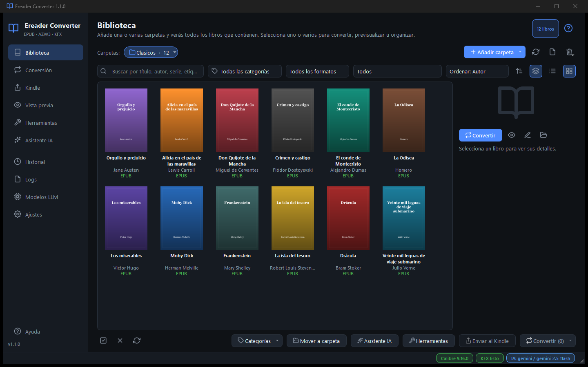

<div align="center">

# 📚 Ereader Converter

**Tu biblioteca de libros electrónicos, ordenada, convertida y en el Kindle.**
Para **Windows** y **macOS**.

[](https://github.com/hendrickcastro/EreaderConverter/releases/latest)
[](https://github.com/hendrickcastro/EreaderConverter/releases)


### [⬇️ Descargar la última versión](https://github.com/hendrickcastro/EreaderConverter/releases/latest)



</div>

---

## ✨ Qué hace

| | |
|---|---|
| 📖 **Biblioteca** | Reúne una o varias carpetas (también en un NAS) y muestra **un libro por fila con todos sus formatos**. Tiene vista de tabla o de tarjetas, búsqueda, filtros, orden y categorías. |
| 🔄 **Conversión** | Convierte entre **EPUB, AZW3, KFX y MOBI**, desde casi cualquier formato. La cola es paralela, con avance por libro, y se recuerda aunque cierres la app. |
| 📲 **Enviar al Kindle** | Por **cable USB**, por **MTP** (Kindle Scribe y modelos de 2024, en Windows) o **por correo** (*Send to Kindle*). Si hace falta, primero convierte el libro y lo envía al terminar. Además, sabe qué libros tiene ya tu Kindle y en qué formato. |
| 👀 **Vista previa** | Muestra el original y el convertido lado a lado, con índice y temas de lectura. Puedes elegir qué formato ver. |
| 🧰 **Herramientas** | Normalizar nombres, organizar en carpetas, metadatos en lote, duplicados y exportar el catálogo. **Todo se simula antes de aplicarse y se puede deshacer.** |
| 🤖 **Asistente IA** *(opcional)* | Completa título, autor, género, sinopsis y más con el proveedor de IA que elijas: OpenRouter, Gemini, OpenAI, Anthropic, Ollama… Lee portadas cuando el libro no tiene texto. Revisas las propuestas antes de aplicarlas. |
| ⬆️ **Se actualiza sola** | Avisa cuando hay una versión nueva y se instala con un clic. |

## 🚀 Instalación

| Sistema | Descarga |
|---|---|
| 🪟 **Windows 10/11** (64 bits) | `EreaderConverter-<versión>-windows-x64.zip` |
| 🍎 **macOS Apple Silicon** (M1, M2, M3…) | `EreaderConverter-<versión>-macos-arm64.dmg` |
| 🍏 **macOS Intel** | `EreaderConverter-<versión>-macos-x64.dmg` |

Todo está en **[Releases](https://github.com/hendrickcastro/EreaderConverter/releases/latest)**.

<details>
<summary><b>🪟 Windows</b></summary>

1. Descomprime el `.zip` donde quieras, por ejemplo en `Documentos`.
2. Abre `EreaderConverter\EreaderConverter.exe`. Deja el `.exe` dentro de su carpeta: necesita la carpeta `_internal` que tiene al lado.
3. La app no está firmada, así que Windows puede avisar la primera vez: pulsa **Más información › Ejecutar de todas formas**.

</details>

<details>
<summary><b>🍎 macOS</b></summary>

1. Abre el `.dmg` y arrastra **EreaderConverter** a **Aplicaciones**.
2. La primera vez, ábrela con **clic derecho › Abrir**, porque la app no está firmada.
3. Si macOS dice que «está dañada», ejecuta esto en Terminal:

   ```bash
   xattr -dr com.apple.quarantine /Applications/EreaderConverter.app
   ```

</details>

### Requisitos

- **[Calibre](https://calibre-ebook.com/download)**, gratuito: es el motor de conversión. La app lo encuentra sola.
- **Para KFX**: los plugins *KFX Output* y *KFX Input*, que la app instala desde *Ajustes › Asistente KFX*, y **Kindle Previewer**.

## ⬆️ Actualizaciones

La app comprueba al abrir si hay una versión nueva. Cuando la hay, aparece **«Actualizar a X»** en la barra inferior: un clic descarga la versión, cierra la app, la actualiza y la vuelve a abrir.

- Tus datos no se tocan: biblioteca, ajustes, claves y cola de conversión.
- Puedes buscar a mano o desactivar la comprobación en **Ajustes › Actualizaciones**.

## 🔒 Privacidad

- Todo se queda **en tu ordenador**: la biblioteca, los ajustes y el historial.
- Las claves de los proveedores de IA se guardan en el **llavero del sistema** (Windows o macOS).
- La app solo se conecta a internet para:
  - buscar actualizaciones en GitHub;
  - usar la IA, si tú la configuras;
  - enviar libros por correo, si tú lo pides.

## ❓ Preguntas frecuentes

<details>
<summary><b>¿Convierte PDF?</b></summary>

Sí, con Calibre. Los PDF escaneados o con maquetación compleja pueden quedar regular: es un límite del propio formato PDF.

</details>

<details>
<summary><b>¿Funciona con libros con DRM?</b></summary>

No. La app detecta el DRM y salta esos libros.

</details>

<details>
<summary><b>¿Y con mi Kindle antiguo?</b></summary>

Sí. Por USB, la app lee el firmware de tu Kindle y elige un formato que pueda abrir (MOBI en los más antiguos, AZW3 o KFX en los modernos).

</details>

---

<div align="center">

<sub>🇬🇧 <b>Ereader Converter</b> is a desktop app for Windows and macOS to organize your e-book library, convert between EPUB/AZW3/KFX/MOBI and send books to your Kindle over USB, MTP or email. <a href="https://github.com/hendrickcastro/EreaderConverter/releases/latest">Download it from Releases</a>. It requires <a href="https://calibre-ebook.com/download">Calibre</a> and updates itself.</sub>

<sub>Hecho por <a href="https://github.com/hendrickcastro">Hendrick Castro</a> · Conversión con <a href="https://calibre-ebook.com">Calibre</a> (GPL) · Plugins KFX de jhowell.</sub>

</div>
